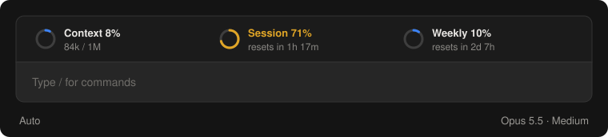

# usage-line

A Claude Code mod that shows three rings above the message box:



- **Context:** how full the session's context window is, in tokens.
- **Session:** how much of the 5-hour limit is used, and when it resets.
- **Weekly:** how much of the weekly limit is used, and when it resets.

A ring turns amber from 70% and red from 90%. The terminal shows the same figures as text.

## Install

Type this at the Claude Code prompt:

```
/plugin install usage-line --marketplace thomthom/claude-usage-line
```

Answer `y` to add the marketplace, then pick a scope. New sessions show the rings.

## Update

```
claude plugin update usage-line
```

## Develop

```
claude plugin validate .
claude plugin test .
```
